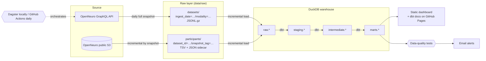

# OpenNeuro Data Pipeline

[](https://github.com/AminMiri2000/openneuro-data-pipeline/actions/workflows/ci.yml)

A batch data pipeline that turns [OpenNeuro](https://openneuro.org), the largest
open neuroimaging archive, into a queryable, tested warehouse. The goal is to
answer questions the OpenNeuro website can't, such as:

> *Which EEG datasets have at least 20 subjects, known age and sex for nearly
> every participant, and a visual task?*

It costs nothing to run: public APIs, local storage, DuckDB, dbt, Dagster and
other open-source tools.

**Live dashboard:** [aminmiri2000.github.io/openneuro-data-pipeline](https://aminmiri2000.github.io/openneuro-data-pipeline/) · [data model docs](https://aminmiri2000.github.io/openneuro-data-pipeline/dbt-docs/) — refreshed daily by GitHub Actions.

## Architecture



## Data model

| Table | Grain | Use it for |
|---|---|---|
| `marts.dim_dataset` | one row per dataset | finding datasets: metadata, tasks, size, and how complete each one's demographics are |
| `marts.fct_participant` | one row per participant | standardised age (years), sex and handedness across all datasets |
| `marts.fct_dataset_daily` | one row per dataset per day | how datasets grow over time (incremental model) |

Participant tables are messy: the same field appears as `age`/`Age`,
`sex`/`gender`/`Gender` or `hand`/`handedness`, with values such as `F`, `f`,
`Female` or a numeric code. The dbt models standardise them in five steps:

1. **Unpivot** each participant's columns into rows.
2. **Match** column names to standard attributes through a lookup seed.
3. **Decode** numeric codes with the dataset's own data dictionary
   (`participants.json` `Levels`, e.g. `"2"` → `"Female"`).
4. **Convert** to standard values, honouring declared units (age in months → years),
   by exact lookup first, then by whole-word patterns for descriptive labels
   such as "Physiological female" or "Right handed (LQ > 0)".
5. **Classify** anything unusable (`unmapped`, `ambiguous`, `undocumented_numeric`,
   `unparseable`, `out_of_range`) instead of silently dropping it, so data
   quality can be measured.

On the 469 EEG datasets (26,174 participants) this standardises **84% of age
values, 90% of sex values and 83% of handedness values**. Most of the rest are
genuinely empty. The pattern step alone moved sex from 85% to 90% and
handedness from 72% to 83%. Bare numeric codes with no data dictionary are
deliberately left unmapped, since datasets disagree on what `1` means.

Extending coverage for a new spelling is a one-line CSV change in
[`transform/seeds/`](transform/seeds), not a SQL change. Every model and column
is documented; run `make docs-serve` to browse them with the lineage graph.

## Monitoring and alerts

Problems are reported by email (Gmail) from both places the pipeline runs.

| Situation | Locally (Dagster) | Daily in the cloud (GitHub Actions) |
|---|---|---|
| A run fails | `email_on_run_failure` sensor | `run --notify` failure digest, plus GitHub's own failed-workflow email |
| A data-quality check warns | `email_on_check_warnings` sensor | `run --notify` digest |
| Data stops refreshing | `email_on_stale_data` sensor (no refresh for 26 hours) | GitHub's failed-workflow email |
| Everything is fine | nothing is sent | nothing is sent |

Each warning is emailed **once**, when it first appears. If it persists, later
emails only count it ("also still present"). It is reported again only if it
clears and comes back. Failures are always emailed. A permanent upstream quirk
(the live data has one dataset listing a participant twice) therefore doesn't
turn into a daily email that trains you to ignore alerts.

Data-quality rules are dbt tests, so they run in every build and show up as
Dagster asset checks. Warn-level rules (`transform/tests/data_quality/`)
include the catalogue shrinking by more than 10% day on day and fewer than 95%
of provided demographic values being standardised. Thresholds are dbt vars in
`dbt_project.yml`.

To receive emails, copy `.env.example` to `.env` and add a Gmail app
password, then check the setup with `openneuro-pipeline notify-test`. For the
daily cloud run, add the same three values as repository secrets.

## Dashboard

`make dashboard` builds a single static page from the marts and previews it at
http://localhost:8081. It has headline figures, six charts (each with a "Show
data" table), a searchable dataset finder and the latest data-test results.
The daily GitHub Actions workflow
([`refresh.yml`](.github/workflows/refresh.yml)) rebuilds it, with the dbt
docs under `/dbt-docs/`, and publishes both to GitHub Pages. The page needs no
server, and `data.json` next to it holds the same numbers for reuse.

## Design decisions

| Decision | Why |
|---|---|
| **Catalogue: daily full snapshot**, partitioned by ingest date | A few thousand rows; re-pulling is cheaper than change-tracking, and the daily partitions give free history of how each dataset evolved. |
| **Participants: incremental by snapshot tag** | One HTTP call per dataset is the expensive part, so it only runs when a dataset publishes a new snapshot. |
| **Incremental load** | A load log stores each raw partition's fingerprint; only new or changed partitions are loaded, each in its own transaction. Load time grows with new data, not history. |
| **Orchestrated as assets** | Dagster shows one lineage graph from the API to each dbt model; dbt tests appear as asset checks. Assets call the same `Pipeline` code as the CLI. |
| **One writer at a time** | DuckDB allows a single writer, so Dagster's run queue runs one job at a time; a scheduled run waits instead of failing. |
| **Retries where failures are transient** | API steps retry with exponential backoff; a failed run is retried once from the failed step. |
| **Quality rules in dbt, delivery in the runner** | Thresholds live next to the models they test; Dagster and the CLI only decide who gets told. Clean runs send nothing, to avoid alert fatigue. |
| **A static dashboard** | Built once a day from tested marts and served as plain files: free hosting, nothing to keep running, and every number traceable to a SQL query in `dashboard/build.py`. |
| **Honest backfills** | OpenNeuro only serves its current state, so past days can't be re-extracted. `make rebuild` replays every step after extraction from the raw files already saved. |
| **Incremental dbt history** | `fct_dataset_daily` re-processes only a short look-back window each run, with delete+insert on its key so re-runs never duplicate. |
| **Raw stays raw; dbt does the cleaning** | Payloads are stored exactly as returned. An API change breaks a visible, tested model, not the loader. |
| **Tests at every layer** | Python unit and integration tests; dbt data tests on every model; dbt unit tests for the standardisation edge cases found in real data. |
| **Parallel, bounded downloads** | Per-dataset fetches run on a small thread pool with thread-local HTTP sessions. |
| **Idempotent, atomic writes** | Deterministic output paths, temp file + rename. Re-running a day overwrites it; a crash leaves nothing half-written. |
| **Failures are isolated and retried** | A dataset that fails is logged, its watermark isn't advanced, and the next run retries it. |
| **Swappable storage** | The pipeline talks to an `ObjectStore` interface; local disk today, S3/GCS by adding one class. |

More detail: [architecture and scalability](docs/architecture.md) and the
decision records:
[0001 free, local-first stack](docs/adr/0001-free-local-first-stack.md),
[0002 layered, incremental design](docs/adr/0002-layered-incremental-design.md),
[0003 dbt modelling and standardisation](docs/adr/0003-dbt-modelling.md),
[0004 orchestration with Dagster](docs/adr/0004-dagster-orchestration.md),
[0005 alerts and dashboard](docs/adr/0005-alerts-and-dashboard.md).

## Quick start

Requires **Python 3.11 to 3.13** and GNU make. Works on Windows (PowerShell or
cmd), macOS and Linux. On Windows, install make with
`winget install GnuWin32.Make` or `choco install make`.

```bash
make install       # virtualenv, dependencies, git hooks
make check-api     # confirm OpenNeuro answers (prints one page)
make run           # extract + load + dbt build (a few minutes for all EEG datasets)
make dagster       # Dagster UI at http://localhost:3000: lineage, runs, schedule
make dashboard     # build the dashboard and preview it at http://localhost:8081
make docs-serve    # browse model docs and lineage at http://localhost:8080
make help          # every other target
```

If your default Python is outside that range, point make at another one, e.g.
`make install SYSTEM_PYTHON="py -3.13"` on Windows.

Then query the marts (read-only):

```bash
make query SQL="SELECT dataset_id, dataset_name, n_subjects, pct_age_known, pct_sex_known FROM marts.dim_dataset ORDER BY n_subjects DESC LIMIT 10"
```

The headline question is answered by
[`transform/analyses/find_eeg_datasets.sql`](transform/analyses/find_eeg_datasets.sql).

In the Dagster UI, open **Automation** and switch on `daily_refresh_schedule`
to refresh the warehouse every day at 06:17 (Toronto time) while Dagster runs.
It is off by default so a fresh clone never calls the API on its own.

Useful options: `--modality MEG|MRI|iEEG|all`, `--limit 20` for a quick trial,
`run --skip-transform`, `transform --select marts`, and `make rebuild`. Any dbt command works through the pipeline,
e.g. `openneuro-pipeline dbt source freshness`. Environment variables are
listed in [`config.py`](src/openneuro_pipeline/config.py).

## Project layout

```
src/openneuro_pipeline/
  sources/openneuro/   GraphQL + S3 client: retries, pagination, thread-local sessions
  storage/             ObjectStore interface + local implementation, key layout,
                       watermarks, file formats
  extract/             Extractor base class, registry, one extractor per entity
  load/                BIDS parsers, one loader per raw table, incremental warehouse load
  transform/           runs dbt in-process via its Python API
  orchestration/       Dagster assets, schedule, alert sensors, run-queue configuration
  alerts/              email digests shared by the CLI and Dagster
  dashboard/           static dashboard: SQL queries over the marts + HTML template
  pipeline.py          wires the layers together (used by the CLI, later by Dagster)
  cli.py               thin command-line entry point
transform/             dbt project
  models/staging/      1:1 with raw tables: typed and renamed (views)
  models/intermediate/ attribute standardisation (views)
  models/marts/        dim_dataset, fct_participant, fct_dataset_daily (tables)
  seeds/               lookup tables for column names and values
  analyses/            example questions answered with the marts
tests/                 Python unit and integration tests (HTTP mocked)
scripts/dev.py         cross-platform helpers used by the Makefile
docs/                  architecture, scalability notes, decision records
```

## Testing

```bash
make test        # Python tests, including a full dbt build and a full Dagster job
make transform   # dbt build: 42 data tests + 2 unit tests on your own data
make lint        # ruff
make typecheck   # mypy --strict
```

CI runs lint, strict type checking and tests on Python 3.11–3.13 and on Windows
for every push and pull request, and fails below 90% coverage. See
[CONTRIBUTING.md](CONTRIBUTING.md) for the branch workflow and conventions.

## Roadmap

- [x] **Phase 1:** batch ingestion to raw storage, DuckDB raw tables, tests, CI
- [x] **Phase 2:** dbt staging, intermediate and mart models with tests and docs
- [x] **Phase 3:** Dagster orchestration: asset lineage, schedule, retries, run queue
- [x] **Phase 4:** data-quality alerts by email, public dashboard on GitHub Pages
- [ ] **Phase 5:** write-up and walkthrough video

## Data and licence

Dataset metadata comes from OpenNeuro; each dataset carries its own licence
(mostly CC0). This repository stores no data, only code. Code is MIT licensed.
