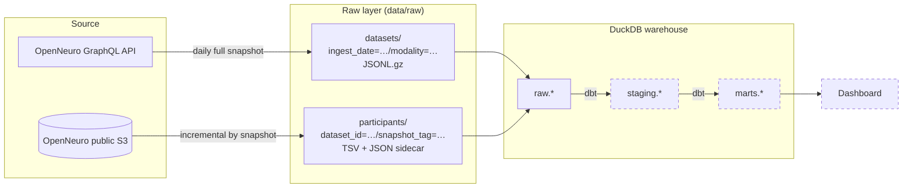

# OpenNeuro Data Pipeline

[](https://github.com/OWNER/openneuro-data-pipeline/actions/workflows/ci.yml)

A batch data pipeline that turns [OpenNeuro](https://openneuro.org), the largest
open neuroimaging archive, into a queryable warehouse. The goal is to answer
questions the OpenNeuro website can't, such as:

> *Which EEG datasets have at least 20 subjects, include age and sex for every
> participant, and use a visual task?*

It costs nothing to run: public APIs, local storage, DuckDB, open-source tools.

## Architecture



Dashed boxes are later phases.

## Design decisions

| Decision | Why |
|---|---|
| **Catalogue: daily full snapshot**, partitioned by ingest date | A few thousand rows; re-pulling is cheaper than change-tracking, and the daily partitions give free history of how each dataset evolved. |
| **Participants: incremental by snapshot tag** | One HTTP call per dataset is the expensive part, so it only runs when a dataset publishes a new snapshot. Watermark in `data/state/`. |
| **Idempotent writes** | Output paths are deterministic and written atomically (temp file + rename). Re-running a day overwrites it; a crash leaves nothing half-written. |
| **Failures are isolated and retried** | HTTP retries with backoff on 429/5xx. A dataset that still fails is logged, its watermark isn't advanced, and the next run retries it. The run exits non-zero so a scheduler notices. |
| **Raw stays raw** | Payloads are stored exactly as returned (JSON). Typing and cleaning happen in dbt, so an API change breaks a visible, tested model, not the loader. |
| **Run manifests** | Each run writes `data/raw/openneuro/_runs/*.json` with counts and error samples, for basic observability. |

Stack choices and rejected alternatives: [ADR 0001](docs/adr/0001-free-local-first-stack.md).

## Quick start

Requires Python 3.11+.

```bash
make install       # virtualenv + dependencies
make check-api     # confirm OpenNeuro answers (prints one page)
make run           # ingest EEG catalogue + participant tables, load into DuckDB
```

Then query it:

```bash
.venv/bin/python -c "import duckdb; print(duckdb.connect('data/warehouse.duckdb').sql('''
  SELECT dataset_id,
         payload->'latestSnapshot'->'description'->>'Name' AS name,
         json_array_length(payload->'latestSnapshot'->'summary'->'subjects') AS n_subjects
  FROM raw.openneuro_datasets
  ORDER BY n_subjects DESC LIMIT 10'''))"
```

Useful flags: `--modality MEG|MRI|iEEG|all`, `--limit 20` for a quick trial run.

## Project layout

```
src/openneuro_pipeline/
  client.py              GraphQL + S3 clients: retries, pagination, partial-error handling
  ingest/datasets.py     catalogue extract (full snapshot)
  ingest/participants.py participants.tsv / .json extract (incremental)
  load.py                raw files -> DuckDB raw schema (transactional rebuild)
  storage.py             atomic writes, state store
  cli.py                 `openneuro-pipeline` command
tests/                   offline test suite (HTTP mocked)
docs/adr/                architecture decision records
```

## Testing

```bash
make test   # 12 tests, ~92% coverage, no network needed
make lint
```

CI runs lint, format check and tests on Python 3.11–3.13 for every push and pull request.

## Roadmap

- [x] **Phase 1:** batch ingestion to raw storage, DuckDB raw tables, tests, CI
- [ ] **Phase 2:** dbt staging and mart models with tests and docs
- [ ] **Phase 3:** Dagster orchestration: schedules, retries, backfills
- [ ] **Phase 4:** data quality alerts, dashboard
- [ ] **Phase 5:** write-up and walkthrough video

## Data and licence

Dataset metadata comes from OpenNeuro; each dataset carries its own licence
(mostly CC0). This repository stores no data, only code. Code is MIT licensed.
