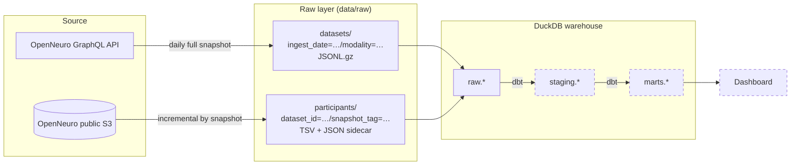

# OpenNeuro Data Pipeline

[](https://github.com/OWNER/openneuro-data-pipeline/actions/workflows/ci.yml)

A batch data pipeline that turns [OpenNeuro](https://openneuro.org), the largest
open neuroimaging archive, into a queryable warehouse. The goal is to answer
questions the OpenNeuro website can't, such as:

> *Which EEG datasets have at least 20 subjects, include age and sex for every
> participant, and use a visual task?*

It costs nothing to run: public APIs, local storage, DuckDB, open-source tools.

## Architecture



Dashed boxes are later phases.

## Design decisions

| Decision | Why |
|---|---|
| **Catalogue: daily full snapshot**, partitioned by ingest date | A few thousand rows; re-pulling is cheaper than change-tracking, and the daily partitions give free history of how each dataset evolved. |
| **Participants: incremental by snapshot tag** | One HTTP call per dataset is the expensive part, so it only runs when a dataset publishes a new snapshot. Watermark in `data/state/`. |
| **Incremental load** | A load log stores each raw partition's fingerprint; only new or changed partitions are loaded, each in its own transaction. Load time grows with new data, not history. |
| **Parallel, bounded downloads** | Per-dataset fetches run on a small thread pool with thread-local HTTP sessions; the size is configurable. |
| **Idempotent writes** | Output paths are deterministic and written atomically (temp file + rename). Re-running a day overwrites it; a crash leaves nothing half-written. |
| **Failures are isolated and retried** | HTTP retries with backoff on 429/5xx. A dataset that still fails is logged, its watermark isn't advanced, and the next run retries it. The run exits non-zero so a scheduler notices. |
| **Raw stays raw** | Payloads are stored exactly as returned (JSON). Typing and cleaning happen in dbt, so an API change breaks a visible, tested model, not the loader. |
| **Run manifests** | Each run writes `data/raw/_system/runs/<step>/<run_id>.json` with metrics, errors and warnings. |
| **Swappable storage** | The pipeline talks to an `ObjectStore` interface; local disk today, S3/GCS by adding one class. |

More detail: [architecture and scalability](docs/architecture.md),
[ADR 0001: free, local-first stack](docs/adr/0001-free-local-first-stack.md),
[ADR 0002: layered, incremental design](docs/adr/0002-layered-incremental-design.md).

## Quick start

Requires Python 3.11+ and GNU make. Works on Windows (PowerShell or cmd),
macOS and Linux. On Windows, install make with `winget install GnuWin32.Make`
or `choco install make`.

```bash
make install       # virtualenv, dependencies, git hooks
make check-api     # confirm OpenNeuro answers (prints one page)
make run           # extract EEG catalogue + participant tables, load into DuckDB
make help          # every other target (backfill, load, test, ...)
```

Then query the warehouse (read-only):

```bash
make query SQL="SELECT dataset_id, payload->'latestSnapshot'->'description'->>'Name' AS name FROM raw.openneuro_datasets LIMIT 10"
```

To run the CLI directly, activate the virtualenv first
(`.venv\Scripts\Activate.ps1` on Windows, `source .venv/bin/activate` elsewhere),
then use `openneuro-pipeline --help`. Activating it also lets the git hooks
find their tools when you commit.

Useful options: `--modality MEG|MRI|iEEG|all`, `--limit 20` for a quick trial,
`--ingest-date 2026-11-01` to backfill a day, `load --full-refresh` to rebuild.
Environment variables (`PIPELINE_MAX_WORKERS`, `PIPELINE_DATA_DIR`, ...) are
listed in [`config.py`](src/openneuro_pipeline/config.py).

## Project layout

```
src/openneuro_pipeline/
  sources/openneuro/   GraphQL + S3 client: retries, pagination, thread-local sessions
  storage/             ObjectStore interface + local implementation, key layout,
                       watermarks, file formats
  extract/             Extractor base class, registry, one extractor per entity
  load/                BIDS parsers, one loader per raw table, incremental warehouse load
  pipeline.py          wires the layers together (used by the CLI, later by Dagster)
  cli.py               thin command-line entry point
tests/unit/            fast tests per module
tests/integration/     extract -> load -> CLI flows, HTTP mocked
docs/                  architecture, scalability notes, decision records
```

## Testing

```bash
make test        # 43 tests, ~97% coverage, no network needed
make lint        # ruff
make typecheck   # mypy --strict
```

CI runs lint, format check, strict type checking and tests on Python 3.11–3.13 for
every push and pull request, and fails below 90% coverage. See
[CONTRIBUTING.md](CONTRIBUTING.md) for the branch workflow and code conventions.

## Roadmap

- [x] **Phase 1:** batch ingestion to raw storage, DuckDB raw tables, tests, CI
- [ ] **Phase 2:** dbt staging and mart models with tests and docs
- [ ] **Phase 3:** Dagster orchestration: schedules, retries, backfills
- [ ] **Phase 4:** data quality alerts, dashboard
- [ ] **Phase 5:** write-up and walkthrough video

## Data and licence

Dataset metadata comes from OpenNeuro; each dataset carries its own licence
(mostly CC0). This repository stores no data, only code. Code is MIT licensed.
