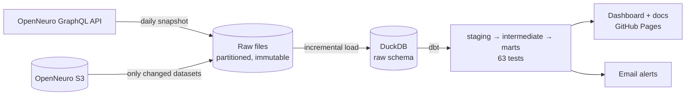

# Making OpenNeuro's EEG data searchable: a free, tested, daily data pipeline

**Live dashboard:** [aminmiri2000.github.io/openneuro-data-pipeline](https://aminmiri2000.github.io/openneuro-data-pipeline/) ·
**Code:** [github.com/AminMiri2000/openneuro-data-pipeline](https://github.com/AminMiri2000/openneuro-data-pipeline)

## The problem

[OpenNeuro](https://openneuro.org) hosts hundreds of public EEG datasets, all
in the BIDS standard. Its website is built for browsing one dataset at a time.
It cannot answer the questions a researcher asks *before* downloading
gigabytes of recordings:

> Which EEG datasets have at least 20 subjects, known age and sex for nearly
> every participant, and a visual task?

My master's research compares EEG classification across several OpenNeuro
datasets, so this is a question I actually have. Answering it needs two kinds
of data. The first is the catalogue (size, tasks, subject counts). The second
is each dataset's `participants.tsv`, a free-form table in which every lab
names and codes its columns differently.

The goal was a pipeline that answers this question reliably, refreshes itself
every day, tells me when something goes wrong, and costs nothing to run.

## What it does

Every morning a GitHub Actions job runs the whole pipeline in about a minute:

1. **Extract:** the full EEG catalogue (469 datasets) from OpenNeuro's GraphQL
   API, plus the participant tables of datasets whose snapshot changed.
2. **Load** the new raw partitions into DuckDB.
3. **Transform** with dbt into three tested tables: `dim_dataset`,
   `fct_participant` and `fct_dataset_daily`.
4. **Check** 63 dbt nodes (seeds, models, data tests, unit tests), and email
   me if anything failed or a new warning appeared.
5. **Publish** a static dashboard and the dbt documentation to GitHub Pages.

Locally, the same steps run as a Dagster asset graph: 16 assets, a daily
schedule, retries and alert sensors.

## The hard part: 26,174 participants, described 435 ways

Each dataset's participant table is written by a different lab. The same
attribute shows up as `age` or `Age`, `sex` or `gender` or `Gender`, `hand` or
`handedness`. Values range from `F` and `f` to `Female`, `Physiological
female`, `Self-identifies as a woman`, or simply `2`.

The standardisation runs in dbt, in five steps:

1. **Unpivot** every participant's columns into rows.
2. **Match** column names to standard attributes through a lookup table (a
   dbt seed), not hard-coded `CASE` statements.
3. **Decode** numeric codes with the dataset's *own* data dictionary
   (`participants.json`). `"2"` only becomes "female" if that dataset says so.
4. **Convert** values: units honoured (ages in months become years), exact
   lookups first, then whole-word patterns for descriptive labels. A value
   matching two categories ("left and right") is marked ambiguous, not guessed.
5. **Classify, don't drop.** Every value gets a status: `ok`, `missing`,
   `unmapped`, `ambiguous`, `undocumented_numeric`, `unparseable` or
   `out_of_range`. Data quality becomes a number to track, not a silent loss.

The results on real data:

| Attribute | Values in participant tables | Standardised | Of the non-empty values | Still unmapped |
|---|---|---|---|---|
| Age | 21,812 | 18,305 (84%) | 99.6% | 0 (69 unusable, e.g. out of range) |
| Sex | 23,291 | 20,884 (90%) | 96.4% | 12 (was 2,020) |
| Handedness | 7,888 | 6,547 (83%) | 97.3% | 45 (was 1,030) |

Most of the remainder is genuinely empty in the source.

The pattern step was driven by data. The first build left 2,020 sex and
1,030 handedness values unmapped. I queried the most frequent ones, wrote
patterns for them, and verified each against the real values before shipping.
The share of sex values standardised went from 85% to 90%, and handedness from 72% to 83%.

What I deliberately did **not** map: bare numbers without a data dictionary
(sex `0`/`1`/`2`, handedness `0.88`). Datasets disagree on whether `1` means
male or female, and handedness scores use study-specific cut-offs. A guess
here would be silently wrong for a whole dataset.

## Design decisions worth explaining

**Two load strategies for two kinds of data.** The catalogue is small, so it
is pulled whole every day into a date-partitioned file. That is simpler than
change tracking, and it builds a free daily history. Participant tables cost
one HTTP call per dataset, so they are fetched only when a dataset publishes a
new snapshot, tracked by a watermark. A second run the same day downloads
nothing.

**Raw stays raw.** API responses and TSV files are stored exactly as
received. All typing and cleaning happens in dbt, where it is versioned,
documented and tested. When OpenNeuro changes something, a visible test
fails; the loader does not quietly corrupt data.

**Idempotent and crash-safe by construction.** Output paths are deterministic
and every write is atomic (temp file, then rename). The warehouse load
replaces partitions in single transactions, tracked by a fingerprint log.
Re-running a day overwrites it; a crash leaves nothing half-written.

**Backfills, honestly.** I originally shipped a `make backfill DATE=…`
command, then removed it. OpenNeuro only serves its *current* state, so
"backfilling last Tuesday" would have stored today's data labelled as
Tuesday. The saved daily raw files are the record of history; `make rebuild`
replays everything after extraction from them.

**One writer at a time.** DuckDB allows a single writer. Dagster's run queue
limits the project to one concurrent run, so a scheduled run waits instead of
failing on a locked file.

**Alerts that stay worth reading.** The first production run found a real
upstream issue: one dataset lists a participant twice. That warning will be
there every day, and a daily email about it would teach me to ignore alerts.
So each warning is emailed once, when it first appears, and again only if it
clears and returns. Failures are always emailed.

**$0, by design.** Public APIs, DuckDB instead of a cloud warehouse, GitHub
Actions and Pages on a public repo. The raw layer sits behind a small
storage interface, and the dbt models are adapter-portable, so moving to
S3 and BigQuery would be a configuration change, not a rewrite.

## Engineering practice

- **Tests at every layer:** 95 Python tests (96% coverage, network fully
  mocked), including a full dbt build and a full Dagster job run, plus dbt data
  tests on every model and dbt unit tests built from real edge cases.
- **CI on every pull request:** lint, `mypy --strict`, tests on Python
  3.11–3.13, and `make install && make test` on Windows in both `cmd.exe` and
  Git bash. The workflow that touches the live API runs on pull requests too,
  without deploying.
- **Architecture decision records** for each phase, including the trade-offs
  I rejected (Airflow, BigQuery, Streamlit, pandas transforms).
- **Branch per change, pull request into `dev`:** 16 pull requests in total.

## What went wrong, and what it taught me

- **"Works on my machine," Windows edition.** The first `make install` failed
  on Windows: the Makefile assumed `.venv/bin`. The fix was portable recipes
  plus a CI job that runs the Makefile on Windows, so it cannot regress.
- **A bug the tests could not see.** The first live run crashed on a
  relative-path comparison. Every test used absolute temporary folders, the
  one case where the bug cannot happen. The fix came with a test for the
  missing case.
- **Dependency reality.** dbt had no wheels for Python 3.15 yet, Dagster's dbt
  integration did not support 3.14, and the two disagreed on protobuf
  versions. The project pins a supported range, and `make install` checks it
  up front with a clear message instead of a compiler error deep in pip.
- **Being wrong about backfills** (above). Correcting a feature I had shipped
  was the right call, and a better story than pretending it worked.

## What I would do next

- Extend to MEG and iEEG (the extractors already take a modality filter).
- Parse `events.tsv` to classify tasks by stimulus type rather than by label.
- Move the raw layer to object storage and make `fct_participant`
  incremental, if the data grows by orders of magnitude.

## Stack

Python · GraphQL · DuckDB · dbt (dbt-duckdb) · Dagster (dagster-dbt) ·
GitHub Actions · GitHub Pages · pytest · mypy · ruff
